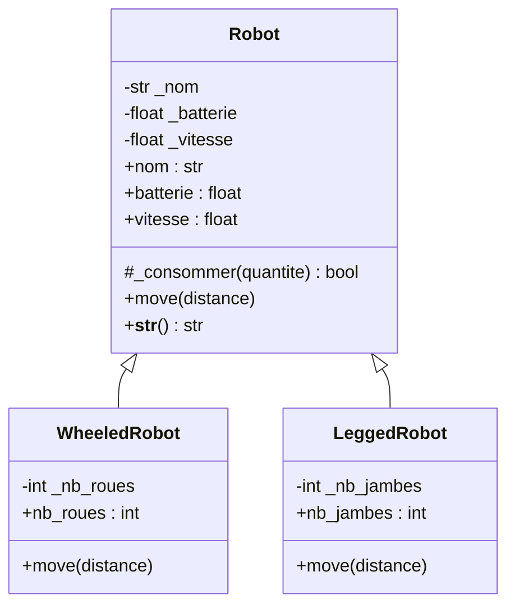
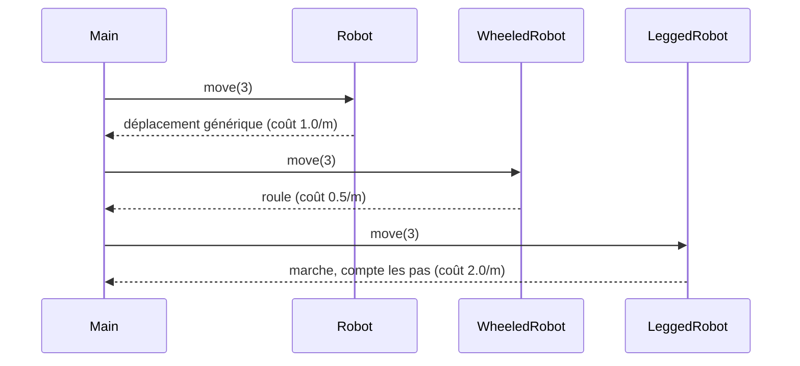

# Test 1 : Classe Robot (Python)

## Architecture

Une classe de base `Robot` et deux sous-classes, `WheeledRobot` (à roues) et `LeggedRobot` (à jambes).

### Diagramme de classes UML



### Diagramme de séquence : polymorphisme de `move()`



## Concepts démontrés

| Concept | Où |
|---|---|
| **Encapsulation** | Attributs privés `_nom`, `_batterie`, `_vitesse`, `_nb_roues`, `_nb_jambes`, accessibles via des propriétés (getters/setters) avec validation (`ValueError`) |
| **Héritage** | `WheeledRobot` et `LeggedRobot` héritent de `Robot` (`super().__init__`) |
| **Polymorphisme** | `move()` est définie dans `Robot` puis redéfinie dans chaque sous-classe ; la boucle du `__main__` l'appelle sans connaître le type exact |
| **Méthode protégée** | `_consommer()` factorise la gestion de la batterie |

## Exécution

```bash
python3 class.py
```

## Extension

Pour ajouter un robot (par exemple `FlyingRobot`), il suffit d'hériter de `Robot` et de redéfinir `move()`. Le code appelant ne change pas.
